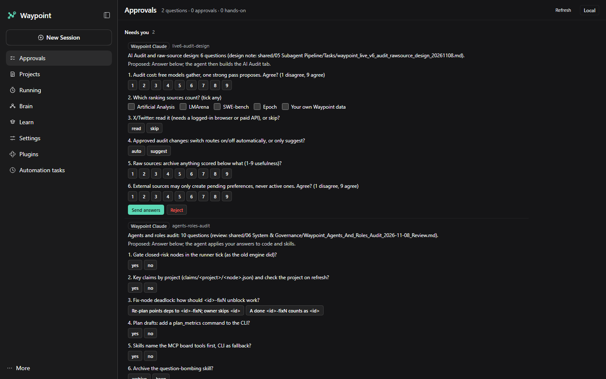
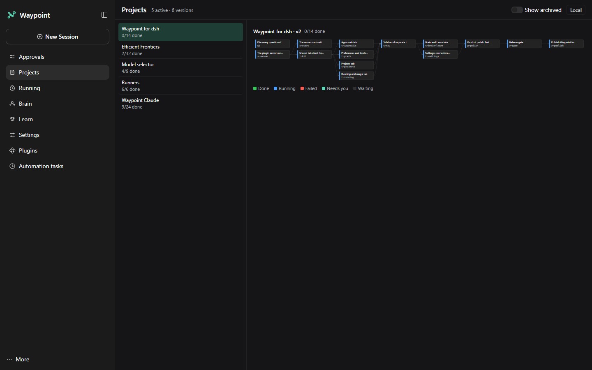
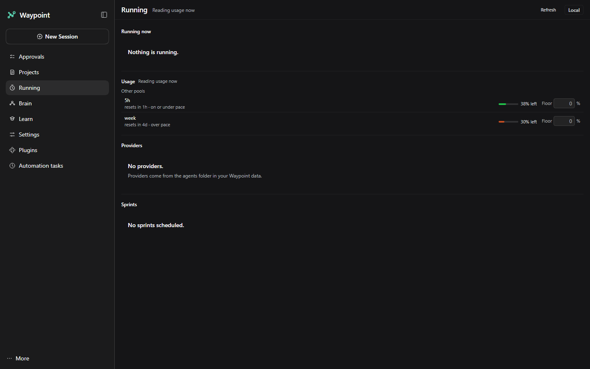

# Waypoint on DeepSeek Harness

Waypoint adds a planning and review layer to [DeepSeek Harness](https://github.com/deepseek-ai/deepseek-harness)
(`dsh`). You describe a goal, Waypoint splits it into small tasks that each have a done-check, hands them to the AI
tools you have switched on, and shows progress, failures and questions in new pages in the dsh sidebar. All state is
a folder of small JSON files on your own machine: no cloud service, no telemetry and no paid API route by default.
This repository holds the dsh plugin and the engine under it (the data library, the runner, the command line and the
Waypoint server).

Built for DeepSeek Harness (MIT licence): <https://github.com/deepseek-ai/deepseek-harness>. Waypoint is an
independent add-on and is not affiliated with DeepSeek.

## Screenshots

Waypoint running inside DeepSeek Harness, on a real data folder (the projects that build Waypoint itself).

**Approvals**: the questions agents asked, answered in one click.



**Projects**: every active project and the task graph of the selected one.



**Running**: what runs now and the usage left in each pool, with floors.



## Install for DeepSeek Harness

You need dsh (`npm i -g @deepseek-ai/dsh`, then run `dsh` once so it creates `~/.dsh`), Node.js 20 or newer and
Python 3.11 or newer. No npm packages.

```powershell
git clone https://github.com/Robert-Study/waypoint-agents.git
cd waypoint-agents
node plugin/tools/build.mjs
python plugin/tools/install.py install
```

Restart dsh. The Waypoint tabs appear in the sidebar and dsh starts the Waypoint server
(`runner/waypoint_runner/wpc_http.py`, port 8762). The plugin finds this repository by itself because it sits inside
it. Point it at another data folder or Python in `~/.waypoint/config.json` (`data_dir`, `python`); see
[plugin/INSTALL.md](plugin/INSTALL.md) for every setting, upgrades and uninstall, and
[plugin/README.md](plugin/README.md) for the tabs.

Check the plugin after an install or a dsh upgrade:

```powershell
node plugin/tools/test.mjs --node-only
python plugin/tools/compat_check.py --dsh-root "$(npm root -g)/@deepseek-ai/dsh"
```

The Preferences, Brain and Learn tabs that need an add-on show only when the Waypoint server reports the add-on is
on. With no add-on installed they stay hidden and nothing errors; see [addons/README.md](addons/README.md).

## Engine and command line

The engine is shared, byte for byte, with the sister repository `waypoint-agents-claude` (the Claude dashboard). The
file `ENGINE_VERSION` names its version and `ENGINE_MANIFEST.sha256` lists a hash for every engine file.

| Part | Where | What it does |
|---|---|---|
| Data library | `core/waypoint-data` | Schemas, a sample data folder and the only code that writes the folder (TypeScript and Python twins). |
| Runner | `runner/waypoint_runner` | Starts when there is work and exits when idle; dispatches tasks, ingests receipts, serves the Waypoint server and the MCP tools. |
| Command line | `scripts/waypoint_cli.py`, `bin/waypoint.cmd` | Read the board, set task status, add and tick to-dos, start versions, check the install. |
| Engine | `engine/cc_engine` | The original HTTP engine and its test suite (plans, checks, scheduler). Standard library only. |
| Docs | `docs/` | File contract, API, CLI, architecture, token economy. |

Install the command line on Windows 10 or 11 with Python 3.10 or newer:

```powershell
powershell -ExecutionPolicy Bypass -File install.ps1
```

Open a new terminal, then:

```powershell
waypoint doctor
waypoint board
waypoint todo add "Read the API docs" --human
```

See [INSTALL.md](INSTALL.md) for switches and troubleshooting, [docs/CLI.md](docs/CLI.md) for every command and
[docs/ARCHITECTURE.md](docs/ARCHITECTURE.md) for how the parts fit.

Run the tests:

```powershell
python -m pytest engine/tests -q
python -m pytest scripts/tests -q
node plugin/tools/test.mjs --node-only
python scripts/export_core.py --scan .
```

## Licence

MIT. See [LICENSE](LICENSE). Built for DeepSeek Harness (MIT licence).
